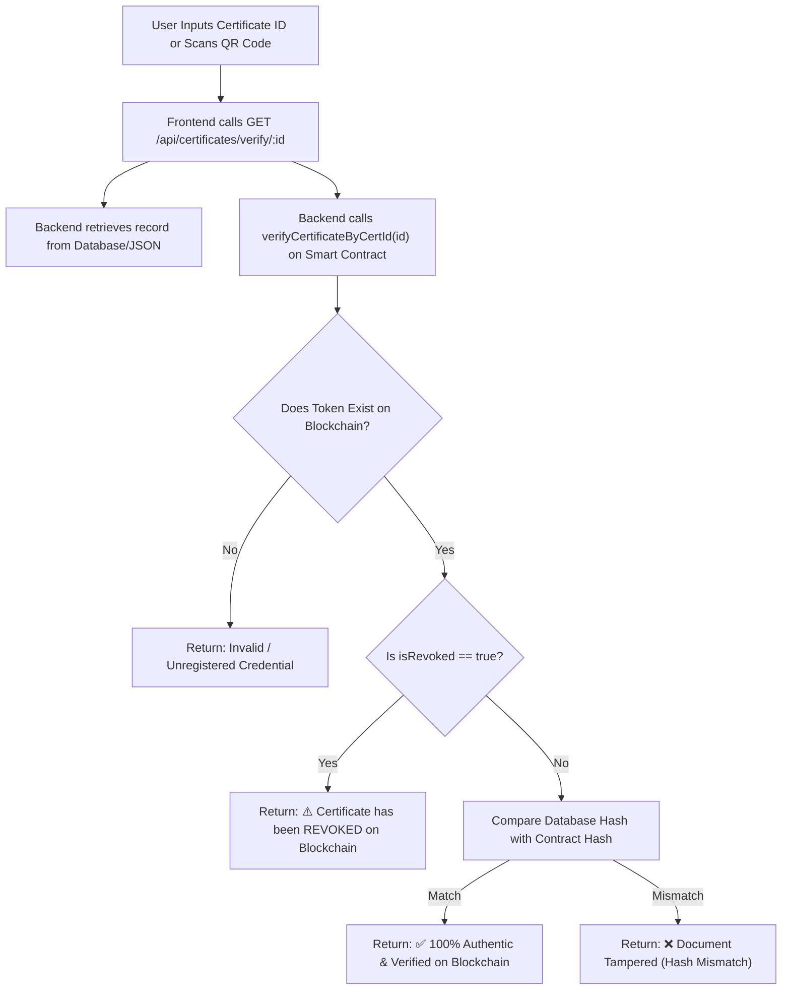

# Blockchain & Smart Contract Explanation Cheat Sheet

> **Document Type:** Pre-Presentation Study Guide & Defense Preparation  
> **Target Audience:** Presenter, Defense Candidate, Technical Interviewee  
> **Core Subject:** Unholy Trinity Verifier — Blockchain Implementation, NFT Mechanics, and Contract Architecture  
> **Contract Name:** `CertificateNFT.sol` (Solidity `^0.8.20`)  
> **Contract Address (Localhost):** `0x5FbDB2315678afecb367f032d93F642f64180aa3`  
> **Network:** Hardhat EVM Node (`http://127.0.0.1:8545`, Chain ID: `31337`)

---

## 1. Foundational Concepts (In Plain English)

### What is a Blockchain?
A blockchain is a **decentralized, distributed, append-only cryptographic ledger**. Instead of storing data on a single centralized database server managed by one company, data is grouped into cryptographic **blocks** linked together using cryptographic hashes. Once a block is committed to the blockchain, it cannot be rewritten, modified, or deleted by anyone. This property is known as **immutability**.

### What is a Smart Contract?
A smart contract is a **self-executing computer program** deployed directly onto a blockchain virtual machine (such as the Ethereum Virtual Machine, or EVM). It defines a set of strict rules, variables, and functions. When a user or application calls a smart contract function, the EVM executes the code deterministically across all nodes on the network. Nobody can tamper with or bypass the contract's rules.

### What is an NFT (ERC-721 Token)?
An **NFT (Non-Fungible Token)** is a smart contract standard (ERC-721 on Ethereum) where each minted token is completely **unique and non-interchangeable**. Unlike cryptocurrencies like Bitcoin or standard ERC-20 tokens (where every coin has identical value), each ERC-721 token has its own distinct `tokenId` and unique metadata. In our project, **each academic certificate is minted as a distinct NFT**, representing an official academic credential owned by the recipient.

### What is Cryptographic Hashing (SHA-256)?
Hashing is a mathematical algorithm that takes any input data (such as a string of student information) and produces a fixed-length string of characters (a 64-character hexadecimal digest). 
Two critical rules govern SHA-256:
1. **Deterministic:** The exact same input will always generate the exact same hash.
2. **Avalanche Effect:** Changing even a single letter, space, or comma in the input causes the resulting hash to change completely.
3. **One-Way:** You cannot reverse-engineer the original certificate data from its hash.

---

## 2. On-Chain vs. Off-Chain Storage Architecture

A common misconception among beginners is that entire documents or PDF files are uploaded directly onto the blockchain. Storing large files on a blockchain is prohibitively expensive and inefficient.

In **Unholy Trinity Verifier**, we use an industry-standard **hybrid storage architecture**:

```text
┌─────────────────────────────────────────────────────────────────────────────┐
│                             WHAT IS STORED WHERE?                            │
├──────────────────────────────────────┬──────────────────────────────────────┤
│       ON-CHAIN (EVM Blockchain)      │    OFF-CHAIN (Database / Local JSON) │
├──────────────────────────────────────┼──────────────────────────────────────┤
│ 1. Certificate ID (Unique String)    │ 1. Complete Certificate Document     │
│ 2. SHA-256 Cryptographic Hash        │ 2. Recipient Name & Course Name      │
│ 3. Student Name & Course Name        │ 3. 300x300 Base64 PNG QR Code Image  │
│ 4. Institution Name                  │ 4. Issue Date & Timestamps           │
│ 5. Issue Timestamp (Unix uint256)    │ 5. Validity Status                   │
│ 6. Issuer Address (Admin Wallet)     │ 6. Cryptographic SHA-256 Hash String │
│ 7. isRevoked (Boolean Flag)          │ 7. Blockchain Transaction Hash       │
│ 8. Token ID Counter (1, 2, 3...)     │ 8. onChain Confirmation Boolean      │
│ 9. Token URI (Metadata Endpoint)     │                                      │
└──────────────────────────────────────┴──────────────────────────────────────┘
```

**Why this matters:** Storing the SHA-256 cryptographic hash on-chain creates an unforgeable "anchor." If anyone modifies the off-chain database record, the recomputed hash will not match the on-chain hash, immediately alerting the system to tampering.

---

## 3. How Certificate Verification Actually Works in this Codebase



---

## 4. Smart Contract Reference Card: `CertificateNFT.sol`

- **File Path:** [`blockchain/contracts/CertificateNFT.sol`](file:///home/nullframe/BLOCKCHAIN_PROJECT/blockchain/contracts/CertificateNFT.sol)
- **Inheritance:** `ERC721`, `ERC721URIStorage`, `Ownable`
- **Compiler Version:** `pragma solidity ^0.8.20;`

### On-Chain Struct:
```solidity
struct Certificate {
    string certificateId;      // e.g., "CERT-1792683461568-A84A68CB"
    string certificateHash;    // SHA-256 64-char hexadecimal string
    string studentName;        // Full recipient name
    string courseName;         // Accredited course or program
    string institutionName;    // "Decentralized Academy"
    uint256 issueDate;         // Unix timestamp
    address issuer;            // Deployer/Admin Ethereum address
    bool isRevoked;            // Revocation state flag
    bool exists;               // Existence flag
}
```

### Key Contract Functions:
1. **`mintCertificate(...) public onlyOwner returns (uint256)`**
   - Mints an ERC-721 token with auto-incrementing `_nextTokenId`.
   - Records the `Certificate` struct on-chain.
   - Populates reverse mappings: `_certificateIdToTokenId`, `_hashToTokenId`, `_certificateIdExists`.
   - Emits the `CertificateMinted` event.
2. **`revokeCertificate(uint256 tokenId) public onlyOwner`**
   - Restrictive admin function that sets `_certificates[tokenId].isRevoked = true`.
   - Increments `totalCertificatesRevoked`.
   - Emits the `CertificateRevoked` event.
   - **Crucial:** Does not delete the token, preserving the immutable audit trail.
3. **`verifyCertificateByCertId(string certId) public view returns (bool isValid, bool isRevoked, uint256 tokenId)`**
   - Gas-free view call returning token authenticity, revocation state, and token ID.
4. **`verifyCertificateByHash(string certHash) public view returns (bool isValid, bool isRevoked, uint256 tokenId)`**
   - Gas-free view call verifying against the SHA-256 hash.

---

## 5. Likely Technical Questions & Model Answers for Project Defense

Here are 16 questions a computer science professor, examiner, or reviewer is likely to ask, along with precise, code-verified answers:

### Q1: Why did you choose blockchain instead of a standard SQL database?
**Answer:**  
*"A standard SQL database has a single point of failure and is controlled by whoever possesses administrative database access. A rogue administrator, compromised server account, or SQL injection attack could quietly alter grades, change names, or delete revocation records without leaving a tamper-proof audit trail. By anchoring each certificate's SHA-256 fingerprint to an Ethereum smart contract, the record becomes permanently immutable. Even the database administrator cannot rewrite past blocks or reverse on-chain timestamps."*

### Q2: Why use an NFT (ERC-721) for certificates rather than an ERC-20 token or standard transaction?
**Answer:**  
*"Academic credentials represent unique, individualized awards conferred to a specific person for a specific achievement. ERC-20 tokens are fungible—each token is identical and interchangeable, like dollar bills. ERC-721 Non-Fungible Tokens are specifically designed to represent unique digital assets. Each minted certificate NFT has a distinct `tokenId`, an unalterable `issueDate`, an institutional `issuer` address, and its own metadata URI. It natively models non-fungible academic accreditation."*

### Q3: What exact data is stored on-chain vs. in MongoDB/JSON?
**Answer:**  
*"We use a hybrid storage pattern. On-chain, the `CertificateNFT` contract stores the unique certificate ID string, the 64-character SHA-256 cryptographic hash, student name, course name, issuing institution, issuance timestamp, issuer address, and an `isRevoked` boolean flag. In our off-chain database, we store the full certificate record, timestamps, and the heavy 300x300 Base64 PNG QR code data URL. This keeps blockchain storage minimal and gas costs virtually zero while maintaining complete cryptographic integrity."*

### Q4: What does the QR code actually contain?
**Answer:**  
*"The QR code encodes the **unique Certificate Reference ID** (e.g., `CERT-1792683461568-A84A68CB`). When scanned by our multi-modal verification terminal or any camera device, it extracts this reference ID and immediately queries the registry and smart contract. The QR code does not contain secret keys; it acts as a high-speed pointer to the public ledger."*

### Q5: How does the system detect if a student has altered their PDF certificate?
**Answer:**  
*"Our system uses deterministic SHA-256 hashing. When a certificate is issued, the backend hashes the recipient's name, course, date, and ID into a 64-character fingerprint and stores it on the blockchain. If an applicant edits their PDF—for example, changing 'Bachelor of Arts' to 'Master of Science'—and submits it for verification, the system recalculates the SHA-256 hash. Because of the avalanche effect, the new hash is completely different. When compared with the hash anchored on the blockchain, the verification fails immediately."*

### Q6: Can an issued certificate be changed or modified?
**Answer:**  
*"No. The `CertificateNFT` smart contract has zero setter functions for existing records. Once a certificate struct is committed during the `mintCertificate` transaction, its parameters are permanent and unalterable on the blockchain. If a university legitimately needs to update a graduate's name or award, the administrator must revoke the original certificate and mint a brand-new certificate with a new token ID."*

### Q7: What happens if an institution needs to cancel a degree (e.g., due to plagiarism)?
**Answer:**  
*"The contract owner calls `revokeCertificate(tokenId)` or `revokeCertificateByCertId(certId)`. In compliance with blockchain immutability, **the record is not deleted**. Instead, the on-chain boolean flag `isRevoked` is set to `true`, and an on-chain event `CertificateRevoked` is broadcast. Future verification checks will return that the certificate existed, but is officially revoked, preserving historical transparency."*

### Q8: What happens if the university's database is hacked, wiped, or corrupted?
**Answer:**  
*"Because the cryptographic fingerprint, student name, degree program, and issuer address are permanently anchored on the blockchain, the university's accreditation records cannot be destroyed. Even if the database server is completely deleted, the institution can reconstruct its entire issuance registry by querying the `CertificateMinted` events directly from the blockchain."*

### Q9: Do employers or background checkers need MetaMask or cryptocurrency to verify a certificate?
**Answer:**  
*"No, absolutely not. That is one of our primary architectural contributions. In typical Web3 applications, users must install MetaMask, switch networks, and pay gas fees. In Unholy Trinity Verifier, verification functions (`verifyCertificateByCertId`) are defined as `public view` functions in Solidity. Our backend calls these view functions using an RPC provider, returning instantaneous verification to the employer's browser completely free of charge and with zero crypto onboarding."*

### Q10: Who pays the gas fees for issuing certificates?
**Answer:**  
*"The issuing educational institution pays the gas fee when executing the `mintCertificate` transaction. In our current implementation running on the local Hardhat node, gas is handled automatically using the deployer wallet (Account #0). In a public testnet or mainnet deployment, the university maintains a funded institutional wallet managed by the backend service."*

### Q11: How do you prevent duplicate certificates from being minted?
**Answer:**  
*"We enforce duplicate prevention at two distinct levels:  
First, in the smart contract, we maintain a mapping: `mapping(string => bool) private _certificateIdExists`. Inside `mintCertificate`, the contract executes: `require(!_certificateIdExists[certificateId], "Certificate ID already exists")`. If an ID is submitted twice, the EVM transaction reverts.  
Second, in our backend ID generator utility, we combine millisecond-precision timestamps with 8 pseudorandom UUID hexadecimal characters (`CERT-[timestamp]-[uuid]`), making duplicate generation statistically impossible."*

### Q12: What happens if the blockchain connection goes down or the node is offline?
**Answer:**  
*"Our backend implements graceful degradation. In `backend/utils/blockchain.js`, the `mintOnBlockchain` function is wrapped in a `try...catch` block. If the local node is unreachable, the backend catches the error, logs it, and returns `{ success: false, hash }`. The controller still saves the certificate in the database with `onChain: false`, allowing administrative work to continue without server crashes."*

### Q13: What is the 'Oracle Problem' in certificate verification, and how does it apply here?
**Answer:**  
*"The Oracle Problem states that a blockchain can guarantee that data has not changed since it was written to the chain, but it cannot know whether the data entered by humans was truthful in the first place. In our project, if a corrupt university staff member enters a completely fake student name into the issuance form, the blockchain will faithfully record and verify that fraudulent credential. Blockchain guarantees data integrity, not initial human truthfulness."*

### Q14: How does the dual-storage fallback work when MongoDB is offline?
**Answer:**  
*"In `backend/config/db.js`, the Mongoose connection attempts to connect to MongoDB with a 2-second timeout. If MongoDB is absent, it sets `isUsingLocalStorage = true`. In `backend/models/Certificate.js`, we wrap the model in a JavaScript Proxy. Whenever the application calls `Certificate.find()` or `new Certificate().save()`, the proxy intercepts the call and reads or writes directly to `backend/data/certificates.json`. The frontend never notices any difference."*

### Q15: What are the main limitations of your current implementation?
**Answer:**  
*"We are completely transparent about three main limitations:  
1. **Network Scope:** We are currently deployed to a local Hardhat EVM node (Chain ID 31337) rather than Ethereum mainnet.  
2. **Access Control:** The `/create` web endpoint currently lacks JWT / OAuth2 institutional login protection.  
3. **Data Privacy:** Student names and course titles are stored plaintext in EVM contract storage. In a commercial production build, student names would be hashed or protected with Zero-Knowledge Proofs for privacy compliance."*

### Q16: How do you know your smart contract is bug-free?
**Answer:**  
*"We have a comprehensive automated test suite in `blockchain/test/CertificateNFT.test.js` containing **40 passing unit tests**. The test suite tests deployment parameters, successful minting, rejection of empty fields, rejection of duplicate IDs, tamper detection, incremental token IDs, revocation by ID, revocation by string, access control (ensuring non-owners cannot mint or revoke), gas-free public verification, ERC-721 interface compliance, and full certificate lifecycles."*

---

## 6. Checklist: What is Implemented vs. What is Planned

### Fully Implemented in Source Code:
- [x] Solidity ERC-721 Smart Contract (`CertificateNFT.sol`)
- [x] Local Ethereum EVM deployment via Hardhat (Cancun, Chain ID 31337)
- [x] On-chain `mintCertificate` function with `onlyOwner` access control
- [x] On-chain `revokeCertificate` function preserving historical data
- [x] On-chain reverse mappings (`certId` to `tokenId`, `hash` to `tokenId`)
- [x] Gas-free public verification view functions
- [x] Ethers.js v6 JSON-RPC integration between Express and EVM
- [x] SHA-256 cryptographic document hashing
- [x] Automated 300x300 Base64 PNG QR code generation
- [x] Collision-resistant certificate ID generation (`CERT-timestamp-uuid`)
- [x] Dual-storage transparent proxy (MongoDB + Local JSON fallback)
- [x] Multi-modal verification terminal (Manual ID, QR Upload, Webcam)
- [x] Client-side vector PDF diploma generator (`jsPDF`)
- [x] 40 passing unit tests in Hardhat

### Honest Assessment of Planned / Missing Features:
- [ ] *No Public Testnet Deployment:* Deployed to local Hardhat node on port 8545 (ready for Sepolia via `hardhat.config.js`).
- [ ] *No Admin Login Screen:* The `/create` route has no JWT or password protection in this prototype.
- [ ] *No IPFS Storage:* Metadata URIs point to the backend REST endpoint rather than decentralized IPFS gateways.
- [ ] *No Zero-Knowledge Privacy:* Student names are stored plaintext in EVM memory.
