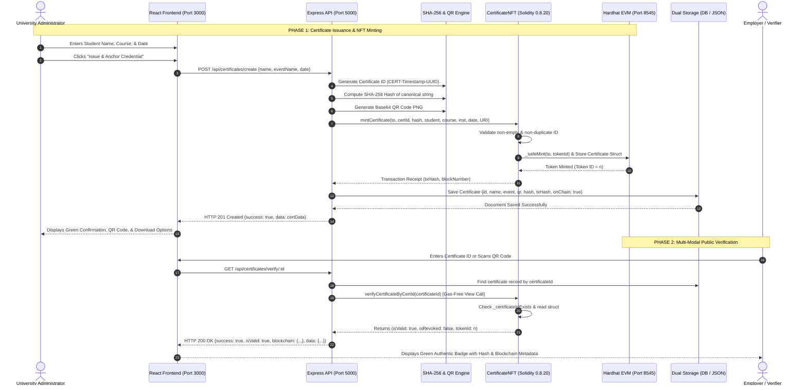

# Unholy Trinity Verifier — Comprehensive Project Analysis & Video Preparation Guide

> **Document Type:** Technical Master Report & Video Reference Manual  
> **Project Name:** Unholy Trinity Verifier — A Decentralized Blockchain for NFT-Based Digital Certificate Verification System  
> **Target Audience:** Project Presenters, Reviewers, Technical Evaluators, and College Audiences  
> **Core Engineering Team:** Dinesh Kumar JB (Lead Developer & Architecture), Sanjay (Core Systems & Verification), Bharath Vikraman (Smart Contract & Ledger Engineering)  
> **Lead Developer GitHub:** [https://github.com/Dineshkumar-jb](https://github.com/Dineshkumar-jb)  
> **Current Workspace State:** Fully Integrated Full-Stack System (Hardhat EVM + Express API + Dual Storage + React 18 SPA)

---

## Table of Contents
1. [Section A: Project Overview](#section-a-project-overview)
2. [Section B: Existing System versus Proposed System](#section-b-existing-system-versus-proposed-system)
3. [Section C: Complete Technology Stack](#section-c-complete-technology-stack)
4. [Section D: System Architecture & Data Flow](#section-d-system-architecture--data-flow)
5. [Section E: Blockchain Implementation Deep-Dive](#section-e-blockchain-implementation-deep-dive)
6. [Section F: Website Interface & Page-by-Page Feature Walkthrough](#section-f-website-interface--page-by-page-feature-walkthrough)
7. [Section G: End-to-End System Workflows](#section-g-end-to-end-system-workflows)
8. [Section H: Backend API & Database Reference](#section-h-backend-api--database-reference)
9. [Section I: Security, Cryptography, & System Limitations](#section-i-security-cryptography--system-limitations)
10. [Section J: Project Novelty & Technical Contributions](#section-j-project-novelty--technical-contributions)
11. [Section K: Local Installation & Execution Manual](#section-k-local-installation--execution-manual)

---

## Section A: Project Overview

### 1. Full Project Title
**Unholy Trinity Verifier — A Decentralized Blockchain for NFT-Based Digital Certificate Verification System**

### 2. Beginner-Friendly Introduction
In the modern educational and employment landscape, thousands of credentials—such as college diplomas, skill certifications, and course completion certificates—are issued digitally every day. However, digital credentials distributed as simple PDF files or printed on standard paper can be forged in minutes using standard graphic editing software.

**Unholy Trinity Verifier** is an academic-grade verification platform that guarantees the authenticity and integrity of digital certificates. It bridges web-based administrative workflows with blockchain technology. Whenever a recognized institution issues a certificate through this platform:
1. A unique certificate identifier is generated.
2. A cryptographic **SHA-256 digital fingerprint** is calculated from the certificate details.
3. An **ERC-721 Non-Fungible Token (NFT)** is minted onto an Ethereum-compatible blockchain ledger.
4. A scannable **QR code** is generated and stamped onto an official printable diploma.

Anyone in the world—an employer, university admissions officer, or background-check agency—can scan the QR code or enter the certificate ID to instantly verify whether the document is genuine, whether it has ever been modified, or whether it has been revoked. All this happens in seconds, without requiring the verifier to pay gas fees, install cryptocurrency wallets, or possess blockchain expertise.

### 3. The Real-World Problem Being Solved
Credential fraud is a billion-dollar global problem. Key industry vulnerabilities include:
- **"Degree Mills" & Fake Certificates:** Unaccredited organizations and fraudulent actors sell counterfeit diplomas that look visually identical to authentic institutional awards.
- **Unauthorized Document Tampering:** A student can easily modify an authentic PDF certificate (changing student name, GPA, honors, or course title) using basic PDF editing tools.
- **Resume Inflation & Unverified CVs:** Employers receive hundreds of job applications with unverified claims because verifying each credential manually is expensive and slow.
- **Administrative Delays:** Traditional background verification relies on telephone calls, physical letters, or manual registrar checks that often take 2 to 6 weeks.

### 4. Why Traditional Certificate Verification is Difficult
Traditional verification workflows suffer from fundamental structural flaws:
1. **Single Point of Failure:** Traditional records are stored in centralized relational databases (e.g., standard SQL/MySQL servers). If the server crashes, database corrupts, or a malicious administrator modifies the database table, historical truth is compromised.
2. **Vulnerability to Insider Threats:** Database administrators or compromised accounts can alter records directly without leaving an immutable audit trail.
3. **Paper Degradation & Loss:** Physical paper certificates can be lost, burned, water-damaged, or fabricated using sophisticated printing techniques.
4. **Lack of Interoperability:** Each university maintains its own closed portal. An employer verifying candidates from ten different colleges must navigate ten disparate portals with varying authentication walls.

### 5. The Proposed Solution: The "Unholy Trinity" Trust Model
The project derives its name—**Unholy Trinity Verifier**—from its tri-fold, multi-layered architectural philosophy. Rather than trusting a single point of failure, trust is anchored across three independent layers:
1. **Layer 1: Cryptographic Integrity (SHA-256 Digest):** Every certificate is mathematically hashed into a 64-character hexadecimal fingerprint. Even a single changed punctuation mark or letter alters the entire hash (the avalanche effect).
2. **Layer 2: Decentralized Ledger Immutability (EVM Smart Contract):** The SHA-256 fingerprint, recipient metadata, and token state are anchored into an ERC-721 smart contract on the blockchain. Once written, no entity (not even the server administrator) can rewrite or erase past blocks.
3. **Layer 3: Authorized Registrar Registry (Dual-Layer Data Store):** Fast querying, full-text searching, high-resolution QR rendering, and instant diploma previews are powered by an optimized backend with automated MongoDB and JSON-file fallback storage.

### 6. Main Objectives
- **Zero-Barrier Public Verification:** Allow verifiers to authenticate certificates in under two seconds without installing MetaMask, holding ETH, or paying gas fees.
- **Non-Fungible Tokenization:** Represent each academic award as an ERC-721 NFT with an auto-incrementing `tokenId` and tamper-proof ownership traceability.
- **Multi-Modal Verification Terminal:** Support manual ID lookup, real-time webcam QR scanning, and drag-and-drop QR image file decoding.
- **Institutional Revocation Support:** Enable institutions to flag credentials as revoked on-chain without violating the immutable history of the blockchain.
- **Fault-Tolerant Resilience:** Ensure continuous operation via a transparent dual-storage fallback architecture that automatically switches between MongoDB Atlas and local JSON persistence.

### 7. Target Users
- **Educational Institutions & Registrars:** University administrators, deans, and certification boards who issue verified academic credentials.
- **Students & Certificate Recipients:** Graduates who receive verifiable digital diplomas, download printable PDF awards, and share verifiable credentials on LinkedIn or CVs.
- **Employers & Corporate HR Teams:** Hiring managers and background-check firms seeking instantaneous, mathematically guaranteed candidate verification.
- **Academic Auditors & Evaluators:** Regulatory bodies assessing institutional compliance and issuance records.

### 8. Main Advantages, Limitations, and Practical Applications
- **Key Advantages:**
  - Fast instant lookups (<150ms local verification).
  - Cryptographically impossible to modify certificate details without invalidating the SHA-256 hash.
  - Revocations are public, transparent, and timestamped on-chain.
  - Zero gas costs for verifiers.
- **Practical Applications:** University degree conferral, vocational bootcamps, continuing medical education (CME), software engineering certifications, and high-security government accreditation.
- **Limitations:** Described honestly in [Section I](#section-i-security-cryptography--system-limitations) (e.g., Oracle problem, local test node scope, and unauthenticated public admin endpoints).

---

## Section B: Existing System versus Proposed System

### 1. Comparative Analysis

| Feature Dimension | Traditional / Existing System | Unholy Trinity Verifier (Proposed) |
| :--- | :--- | :--- |
| **Storage Architecture** | Centralized SQL/NoSQL Database or Paper Archives | Hybrid Tri-Fold: EVM Blockchain + SHA-256 + Dual DB/JSON Storage |
| **Tamper Resistance** | Vulnerable to database alterations, SQL injection, and PDF edits | Cryptographically locked via SHA-256 digest anchored into ERC-721 smart contract |
| **Verification Speed** | 3 to 30 days via manual registrar emails or phone calls | Instant (<2 seconds) via QR scan or reference ID lookup |
| **Single Point of Failure** | High: Registrar server outage blocks all verifications | Low: On-chain ledger persists independently of web server state |
| **Revocation Tracking** | Internal database flag; rarely visible to outside employers | On-chain `isRevoked` state flag emitted via blockchain events |
| **User Barrier to Entry** | Manual contact forms or paid third-party verification services | Free, zero-login, zero-crypto-wallet public web terminal |
| **Audit Trail** | Mutable server logs that can be cleared or overwritten | Immutable block history with transaction hashes and block numbers |

### 2. Improvements Blockchain Provides in this Implementation
1. **Decentralized Permanence:** Even if the university's primary web portal is taken offline or the organization rebrands, the token record and cryptographic hash remain permanently accessible on the Ethereum Virtual Machine (EVM).
2. **Immutable Revocation Audit:** When an institution revokes a credential (e.g., due to academic dishonesty), the smart contract executes `revokeCertificate(tokenId)`. Crucially, **the record is not deleted**. Instead, `isRevoked` is set to `true`, and an on-chain event `CertificateRevoked` is emitted. This preserves historical truth while warning future employers.
3. **Issuer Authenticity:** Each minted NFT logs the `issuer` address (the institutional administrator's cryptographic wallet address), creating irrefutable proof of who authorized the credential.

### 3. Problems That Still Remain Unsolved (Honest Assessment)
- **The "Garbage-In, Garbage-Out" Oracle Problem:** Blockchain guarantees that data has not changed since it was written to the chain; it **cannot** guarantee that the administrator entered correct data initially. If an administrator issues a degree to an unqualified student, the blockchain immutably verifies that fraudulent degree.
- **Private Key Compromise:** If an institution's private key is leaked or stolen, an unauthorized party could mint legitimate-looking tokens until the contract ownership is transferred.
- **Off-Chain Data Synchronization:** If the local database is wiped and the contract address is lost, reconstituting the mapping requires indexing blockchain event logs.

---

## Section C: Complete Technology Stack

The following table reflects the **actual implemented dependencies and modules** found in the workspace:

| Technology / Library | Version | Purpose in this Project | Actual Files / Modules Where Used | Communication / Interaction |
| :--- | :--- | :--- | :--- | :--- |
| **Solidity** | `^0.8.20` | Smart contract language for NFT logic | [`blockchain/contracts/CertificateNFT.sol`](file:///home/nullframe/BLOCKCHAIN_PROJECT/blockchain/contracts/CertificateNFT.sol) | Compiled by Hardhat into EVM bytecode & ABI |
| **OpenZeppelin Contracts** | `^5.6.1` | Battle-tested ERC-721, URIStorage, and Ownable contracts | [`blockchain/contracts/CertificateNFT.sol`](file:///home/nullframe/BLOCKCHAIN_PROJECT/blockchain/contracts/CertificateNFT.sol) | Inherited directly by `CertificateNFT` contract |
| **Hardhat** | `^2.29.1` | Local Ethereum node, compilation, and testing framework | [`hardhat.config.js`](file:///home/nullframe/BLOCKCHAIN_PROJECT/hardhat.config.js), [`blockchain/scripts/deploy.js`](file:///home/nullframe/BLOCKCHAIN_PROJECT/blockchain/scripts/deploy.js) | Runs local EVM on port 8545 (Chain ID 31337) |
| **Ethers.js** | `^6.13.0` | Blockchain interaction library | [`backend/utils/blockchain.js`](file:///home/nullframe/BLOCKCHAIN_PROJECT/backend/utils/blockchain.js) | Connects Express backend to Hardhat node via JSON-RPC |
| **Node.js & Express** | `^4.18.2` | RESTful API server & orchestration | [`backend/server.js`](file:///home/nullframe/BLOCKCHAIN_PROJECT/backend/server.js), [`backend/routes/certificateRoutes.js`](file:///home/nullframe/BLOCKCHAIN_PROJECT/backend/routes/certificateRoutes.js) | Serves endpoints on port 5000, proxies requests |
| **Crypto (Node.js)** | Built-in | Computes SHA-256 cryptographic fingerprints | [`backend/utils/blockchain.js`](file:///home/nullframe/BLOCKCHAIN_PROJECT/backend/utils/blockchain.js) | Hashes `${name}-${eventName}-${date}-${certificateId}` |
| **Mongoose** | `^7.0.0` | MongoDB Object Data Modeling (ODM) | [`backend/models/Certificate.js`](file:///home/nullframe/BLOCKCHAIN_PROJECT/backend/models/Certificate.js), [`backend/config/db.js`](file:///home/nullframe/BLOCKCHAIN_PROJECT/backend/config/db.js) | Connects to MongoDB when available |
| **Dual Storage Fallback** | Custom Proxy | Transparent fallback from MongoDB to local JSON | [`backend/models/Certificate.js`](file:///home/nullframe/BLOCKCHAIN_PROJECT/backend/models/Certificate.js), [`backend/data/certificates.json`](file:///home/nullframe/BLOCKCHAIN_PROJECT/backend/data/certificates.json) | Transparently intercepts database queries |
| **QRCode (Node.js)** | `^1.5.3` | Generates 300x300 Base64 PNG QR code data URLs | [`backend/utils/qrCodeGenerator.js`](file:///home/nullframe/BLOCKCHAIN_PROJECT/backend/utils/qrCodeGenerator.js) | Encodes certificate ID into QR image |
| **UUID (v4)** | `^9.0.0` | Collision-resistant certificate ID generation | [`backend/utils/idGenerator.js`](file:///home/nullframe/BLOCKCHAIN_PROJECT/backend/utils/idGenerator.js) | Combines timestamp with first 8 hex characters |
| **React** | `^18.2.0` | Component-based frontend user interface | [`frontend/src/App.js`](file:///home/nullframe/BLOCKCHAIN_PROJECT/frontend/src/App.js), [`frontend/src/index.js`](file:///home/nullframe/BLOCKCHAIN_PROJECT/frontend/src/index.js) | Renders client SPA on port 3000 |
| **React Router DOM** | `^6.11.0` | Client-side routing and page navigation | [`frontend/src/App.js`](file:///home/nullframe/BLOCKCHAIN_PROJECT/frontend/src/App.js) | Manages routes (`/`, `/admin`, `/create`, `/verify`, `/certificate/:id`) |
| **Axios** | `^1.4.0` | HTTP client for frontend API calls | [`frontend/src/services/certificateService.js`](file:///home/nullframe/BLOCKCHAIN_PROJECT/frontend/services/certificateService.js) | Communicates with Express API at `http://localhost:5000/api` |
| **Html5-Qrcode** | `^2.3.8` | Real-time webcam scanning and QR image decoding | [`frontend/src/pages/VerifyCertificate.js`](file:///home/nullframe/BLOCKCHAIN_PROJECT/frontend/src/pages/VerifyCertificate.js) | Reads camera video stream and image files |
| **jsPDF** | `^4.2.1` | Client-side PDF generation for formal certificates | [`frontend/src/services/pdfGenerator.js`](file:///home/nullframe/BLOCKCHAIN_PROJECT/frontend/src/services/pdfGenerator.js) | Renders landscape PDF diploma with stamps & QR |
| **Lucide React** | `^1.61.0` | Clean vector iconography across all views | Used throughout all pages in `frontend/src/pages/` | Visual indicators, status badges, and action icons |
| **Vanilla CSS** | Standard | Component-scoped stylesheets with design tokens | `frontend/src/App.css`, `frontend/src/pages/*.css` | Custom light/clean theme with sky blue accents |

> **Technologies NOT in implementation:**
> - **MetaMask for Verifiers:** *Not required.* Public verifiers do not need MetaMask. The backend holds the authorized issuer key.
> - **IPFS:** *Not used.* Metadata URIs point to the backend REST endpoint (`http://localhost:5000/api/certificates/${certificateId}`).
> - **Public Ethereum Mainnet:** *Not used.* The project runs on a local Hardhat EVM node (Chain ID 31337).

---

## Section D: System Architecture & Data Flow

```mermaid
graph TD
    subgraph ClientLayer ["1. Presentation Layer (React 18 SPA - Port 3000)"]
        UI_Home["Home Page (Instant Lookup & Quick Chips)"]
        UI_Create["Issue Certificate (Live Preview & Validation)"]
        UI_Verify["Verification Terminal (Manual, Webcam, QR Upload)"]
        UI_Admin["Audit Registry (Search, Metrics, Table)"]
        UI_View["Diploma Presentation (Print, jsPDF Download)"]
    end

    subgraph APILayer ["2. Application Gateway (Express 4.18 - Port 5000)"]
        Router["Express Router (/api/certificates)"]
        Controller["Certificate Controller (Business Logic)"]
        IDGen["ID Generator (CERT-Timestamp-UUID)"]
        QRGen["QR Engine (qrcode Base64 Generator)"]
        HashGen["Crypto Engine (SHA-256 Digest)"]
        BCUtil["Blockchain Bridge (ethers.js v6)"]
    end

    subgraph DataStorageLayer ["3. Dual-Layer Storage Layer"]
        Proxy["Mongoose Dual Storage Proxy"]
        MongoDB[("Primary: MongoDB Atlas / Localhost")]
        LocalJSON[("Fallback: backend/data/certificates.json")]
    end

    subgraph BlockchainLayer ["4. Decentralized Ledger (Hardhat EVM - Port 8545)"]
        EVMNode["Hardhat Cancun Node (Chain ID 31337)"]
        SmartContract["CertificateNFT (ERC-721 + Ownable)"]
        OnChainStruct["On-Chain Storage (Cert Struct, TokenID, Hashes)"]
    end

    %% Interactions
    UI_Create -->|POST /create {name, eventName, date}| Router
    UI_Verify -->|GET /verify/:id| Router
    UI_Home -->|GET /verify/:id| Router
    UI_Admin -->|GET /| Router
    UI_View -->|GET /:id| Router

    Router --> Controller
    Controller --> IDGen
    Controller --> QRGen
    Controller --> HashGen
    Controller --> BCUtil

    BCUtil -->|mintCertificate() via JSON-RPC| SmartContract
    BCUtil -->|verifyCertificateByCertId() view call| SmartContract
    SmartContract --> OnChainStruct
    SmartContract -.->|Runs on| EVMNode

    Controller --> Proxy
    Proxy -->|If MongoDB Available| MongoDB
    Proxy -->|If MongoDB Offline| LocalJSON
```

### Detailed Information Flow Across Connections:
1. **Frontend to Backend (`HTTP / JSON`):** The React frontend sends JSON payloads via Axios to `http://localhost:5000/api/certificates`. All cross-origin requests are authorized via the Express `cors()` middleware.
2. **Backend to Cryptographic Engine (`Node.js Native Crypto`):** When creating a certificate, the controller compiles four parameters into a canonical string: `${name}-${eventName}-${date}-${certificateId}` and hashes it with SHA-256 to create a 64-character hexadecimal digest.
3. **Backend to Blockchain (`ethers.JsonRpcProvider` over HTTP):** The backend initializes an ethers wallet using Hardhat Account #0's private key (`0xac09...f880`). It dispatches an unsigned transaction call to the smart contract method `mintCertificate(...)`. The local node mines the block and returns a transaction receipt containing `txHash` and `blockNumber`.
4. **Backend to Dual-Storage Proxy:** The backend model uses a JavaScript `Proxy` wrapping Mongoose. If MongoDB is connected, it saves to the MongoDB collection; if MongoDB is unavailable, it writes directly to `backend/data/certificates.json` without throwing an error.

---

## Section E: Blockchain Implementation Deep-Dive

### Answers to the 17 Core Technical Questions:

#### 1. Is blockchain genuinely integrated into the current application?
**YES.** Blockchain is actively integrated. The backend imports `ethers.js`, connects to an active Ethereum Virtual Machine (Hardhat node), and calls smart contract methods to mint ERC-721 tokens and verify on-chain records.

#### 2. Which blockchain is used?
The application uses the **Ethereum Virtual Machine (EVM)** running on a local Hardhat blockchain network with the **Cancun EVM execution version**.

#### 3. Is the project deployed to a public blockchain, a local blockchain, a testnet, or a private network?
It is deployed to a **local development blockchain** hosted at `http://127.0.0.1:8545` with **Chain ID 31337**. The `hardhat.config.js` is structured so it can be deployed to public testnets like Sepolia by supplying a testnet RPC URL and private key.

#### 4. Which smart contract is used?
The smart contract is named **`CertificateNFT`**, located in [`blockchain/contracts/CertificateNFT.sol`](file:///home/nullframe/BLOCKCHAIN_PROJECT/blockchain/contracts/CertificateNFT.sol).

#### 5. What programming language is the contract written in?
The contract is written in **Solidity `^0.8.20`** (compiled with Hardhat Solidity compiler version `0.8.24`).

#### 6. What functions does the smart contract expose?
- **`mintCertificate(address to, string certificateId, string certificateHash, string studentName, string courseName, string institutionName, uint256 issueDate, string metadataURI)`:** Restrictive write function (onlyOwner) that mints an ERC-721 token, increments the token ID counter, records the Certificate struct, and sets up hash-to-tokenId reverse mappings.
- **`revokeCertificate(uint256 tokenId)`:** Restrictive write function (onlyOwner) that sets `isRevoked = true` for a given token ID and emits a `CertificateRevoked` event.
- **`revokeCertificateByCertId(string certificateId)`:** Helper function to revoke using the readable certificate string.
- **`verifyCertificateByHash(string certificateHash)`:** Public view function returning `(bool isValid, bool isRevoked, uint256 tokenId)`.
- **`verifyCertificateByCertId(string certificateId)`:** Public view function returning `(bool isValid, bool isRevoked, uint256 tokenId)`.
- **`certificateExists(string certificateId)`:** Public view boolean check.
- **`getCertificate(uint256 tokenId)`:** Public view function returning all struct attributes.
- **`getCertificateByCertId(string certId)`:** Public view function retrieving certificate data by certificate ID string.
- **`getTokenIdByCertificateId(string certificateId)`:** Returns the uint256 token ID for a certificate string.
- **`getNextTokenId()`:** Returns the next incremental token ID to be minted.

#### 7. What data is stored on-chain?
Stored inside the EVM contract state:
- `certificateId` (`string`, e.g., `"CERT-1792683461568-A84A68CB"`)
- `certificateHash` (`string`, 64-char hexadecimal SHA-256 digest)
- `studentName` (`string`, recipient's full name)
- `courseName` (`string`, degree or course name)
- `institutionName` (`string`, issuing organization)
- `issueDate` (`uint256`, Unix timestamp)
- `issuer` (`address`, Ethereum address of the admin who minted)
- `isRevoked` (`bool`, revocation flag)
- `exists` (`bool`, existence flag)
- Reverse mappings: `_certificateIdToTokenId`, `_hashToTokenId`, `_certificateIdExists`.
- Counters: `totalCertificatesMinted`, `totalCertificatesRevoked`.

#### 8. What data is stored in MongoDB or local JSON storage?
- `_id` (UUID or MongoDB ObjectId)
- `name` (Student name)
- `eventName` (Course or degree event name)
- `date` (ISO date string)
- `certificateId` (Unique ID)
- `qrCode` (Complete Base64 Data URL string of the generated PNG QR image)
- `isValid` (Boolean flag)
- `certificateHash` (SHA-256 hash string)
- `txHash` (Blockchain transaction hash string)
- `onChain` (Boolean flag indicating whether blockchain minting succeeded)
- `createdAt` and `updatedAt` timestamps

#### 9. Is an NFT actually minted?
**YES.** An ERC-721 compliant Non-Fungible Token is genuinely minted. The smart contract calls OpenZeppelin's internal `_safeMint(to, tokenId)`, assigning the token to the recipient address and setting the `tokenURI` to the certificate's metadata endpoint.

#### 10. Does the application use a wallet such as MetaMask?
- **For Institutional Issuance:** The backend handles signing programmatically using the deployer's private key (`0xac09...f880`) via ethers.js. This eliminates the need for administrators to approve browser popups for every student.
- **For Public Verifiers & Students:** **No wallet is required.** Verifiers interact through standard HTTP GET calls. The backend calls `view` functions on the contract that execute off-chain gas-free queries.

#### 11. How does the frontend or backend interact with the blockchain?
The frontend does not communicate with the blockchain directly; it communicates through the Express API. The backend interacts with the blockchain using **ethers.js v6**:
```javascript
const provider = new ethers.JsonRpcProvider('http://127.0.0.1:8545');
const signer = new ethers.Wallet(PRIVATE_KEY, provider);
const contract = new ethers.Contract(contractAddress, ABI, signer);
```

#### 12. What is the transaction lifecycle?
1. Administrator fills out the form on `/create` and clicks **"Issue & Anchor Credential"**.
2. Frontend sends `POST /api/certificates/create`.
3. Backend creates the SHA-256 hash and calls `contract.mintCertificate(...)`.
4. Transaction is broadcast to the Hardhat local node.
5. Node validates that `msg.sender == owner()`, assigns `tokenId`, writes struct data to contract storage, and emits `CertificateMinted`.
6. Transaction is mined into a block.
7. Backend waits for receipt: `await tx.wait()`.
8. Backend receives receipt containing `txHash` and `blockNumber`.
9. Backend saves record to database with `txHash` and `onChain: true`.
10. Frontend displays green confirmation badge with transaction hash.

#### 13. How are transaction hashes, block numbers, contract addresses, and transaction receipts handled?
- The **Contract Address** is written to `blockchain/deployments/deployment.json` and mirrored into `backend/contracts/deployment.json` and `frontend/src/contracts/deployment.json`.
- The **Transaction Hash** is extracted from `tx.hash` and stored in the database record. It is displayed in the verification terminal and certificate inspection screens.

#### 14. How is certificate authenticity checked against blockchain data?
When `/api/certificates/verify/:id` is requested:
1. Backend invokes the smart contract's view function: `verifyCertificateByCertId(id)`.
2. The contract checks `_certificateIdExists[id]`.
3. If found, it reads `_certificates[tokenId]` and returns `(isValid, isRevoked, tokenId)`.
4. If `isRevoked == true`, backend reports that the certificate is revoked.
5. If `isValid == true` and not revoked, backend confirms the document is 100% authentic.

#### 15. Can a certificate be revoked or updated?
- **Revoked:** **YES.** The contract owner can invoke `revokeCertificate(tokenId)` or `revokeCertificateByCertId(certificateId)`.
- **Updated:** **NO.** Immutability is strictly enforced. The smart contract provides no setter functions for student name, course, or hash. If a student's name is legally changed, the original certificate must be revoked and a new one issued.

#### 16. What happens if the blockchain connection fails?
The backend implements **fault-tolerant graceful degradation**. In [`backend/utils/blockchain.js`](file:///home/nullframe/BLOCKCHAIN_PROJECT/backend/utils/blockchain.js), the `mintOnBlockchain` function wraps execution in a `try...catch` block. If the Hardhat node is offline:
- The error is logged.
- The function returns `{ success: false, hash }`.
- The controller still creates the certificate in the database with `onChain: false`.
- The application remains operational and does not crash.

#### 17. What security and privacy limitations exist?
- **Public Data Visibility:** Ethereum data is transparent. Student names and course titles are stored plaintext in contract storage. In a real-world enterprise deployment, zero-knowledge proofs (ZKP) or salted hashes would be preferred for student privacy.
- **Admin Authentication:** In the current prototype, `/create` is accessible via the web interface without a password or JWT token. In production, role-based access control (RBAC) must protect the issuance endpoint.

---

## Section F: Website Interface & Page-by-Page Feature Walkthrough

The frontend is a clean, academic-grade Single Page Application (SPA) designed with a professional light theme (`#FFFFFF` cards, `#F8FAFC` slate canvas, `#0F172A` navy typography, `#0284C7` sky-blue accents, and `#059669` emerald verification highlights).

### 1. Homepage (`/`)
- **Header & Navigation:** Displays the brand icon (`ShieldCheck`), brand title **Unholy Trinity Verifier**, navigation links (**Verify Credential**, **Issue Certificate**, **Registry Ledger**), and an active node status pill indicating `EVM NODE ACTIVE: 31337`.
- **Hero Section:** Clear title: *"Autonomous Academic Credential Verification Powered by EVM Smart Contracts"*. Explains the platform's purpose to visitors.
- **Instant Lookup Terminal:** Embedded search input in the hero allowing visitors to paste a certificate ID (e.g., `CERT-1792683461568-A84A68CB`) and hit Enter or click **Verify Credential**.
- **Sample Verification Chips:** Three clickable pills pre-populated with real database records:
  - `Dr. Alan Turing` (`CERT-1792683461568-A84A68CB`)
  - `Elena Rostova` (`CERT-1792682280545-A4E08921`)
  - `Satoshi Nakamoto` (`CERT-1792675186461-9F6767E5`)  
  Clicking any chip instantly executes verification.
- **Instant Result Modal / Card:** Pops up on verification with an emerald status border, recipient name, degree name, issuance date, SHA-256 hash copy button, and a button to view the full diploma.
- **Tri-Fold Trust Architecture Showcase:** Visual three-column section explaining:
  1. *Cryptographic Fingerprint (SHA-256)*
  2. *EVM Blockchain Ledger (ERC-721)*
  3. *Authorized Registrar Repository (Dual Storage)*
- **Interactive Certificate Preview:** Visual mockup of a diploma showing the dynamic watermark, seal, and live verification badges.
- **Project Team Section:** Highlights the core engineering team:
  - **Dinesh Kumar JB** — Lead Developer & Architecture (with clickable GitHub link to [https://github.com/Dineshkumar-jb](https://github.com/Dineshkumar-jb))
  - **Sanjay** — Core Systems & Verification
  - **Bharath Vikraman** — Smart Contract & Ledger Engineering
- **Presenter Instructions for Video:**  
  *Open `http://localhost:3000`. Scroll smoothly down the hero. Point out the instant lookup bar. Click the "Dr. Alan Turing" chip to show instant sub-second verification. Scroll to the Tri-Fold architecture and team section.*

---

### 2. Issue Certificate (`/create`)
- **Page Purpose:** Administrative interface for issuing new accredited credentials and minting on-chain NFT tokens.
- **Left Column (Issuance Form):**
  - **Recipient Full Name:** Text input with user icon (e.g., `Alexander Wright`).
  - **Academic Degree / Event Program:** Text input with award icon (e.g., `M.S. in Cryptographic Engineering`).
  - **Conferral Date:** Date picker (defaults to today's date).
  - **Action Button:** **"Issue & Anchor Credential"** with loading spinner state.
- **Right Column (Live Interactive Preview):**
  - Updates in real-time as the administrator types into the form inputs.
  - Shows simulated diploma layout, recipient name placeholder, degree title, official watermark, and simulated QR seal.
- **Success State (Post-Issuance):**
  - Displays confirmation banner: *"Academic credential successfully issued and anchored to the ledger."*
  - Shows generated Certificate ID (`CERT-[timestamp]-[uuid]`).
  - Shows generated 64-character SHA-256 hash with a one-click copy button.
  - Shows scannable Base64 QR code image.
  - Action buttons: **"Download QR Code"**, **"Export Official PDF"**, and **"View in Registry"**.
- **Presenter Instructions for Video:**  
  *Navigate to "Issue Certificate". Show how typing "Alexander Wright" dynamically updates the preview card on the right. Submit the form. Highlight the green success alert, copy the SHA-256 hash, and click "Export Official PDF" to show client-side PDF generation.*

---

### 3. Verification Terminal (`/verify`)
- **Page Purpose:** Multi-modal public verification portal for employers and background checkers.
- **Three Input Modalities (Tabbed Interface):**
  1. **Manual Reference Lookup:** Text input allowing direct pasting of a Certificate ID with an instant **"Verify Identifier"** button.
  2. **Live Webcam Scanner:** Activates device camera via `html5-qrcode`. Verifiers can hold a physical paper diploma's QR code up to the webcam for automatic hands-free scanning.
  3. **QR Image Upload:** Drag-and-drop file upload zone. Verifiers can drop a screenshot or PNG/JPEG image of a QR code to decode and verify it instantly.
- **Verification Outcomes Displayed:**
  - **Authentic Outcome (Green):** Displays green shield, verified status, recipient name, degree event, conferral date, SHA-256 cryptographic digest, blockchain transaction hash, and token ID.
  - **Invalid Outcome (Red):** If an invalid ID (e.g., `CERT-FAKE-999`) is submitted, a red alert banner appears stating *"No matching academic credential found in the registry."*
  - **Revoked Outcome (Amber):** If a certificate is revoked on-chain, displays a warning: *"⚠️ Certificate has been REVOKED on Blockchain"*.
- **Presenter Instructions for Video:**  
  *Navigate to `/verify`. Enter `CERT-1792683461568-A84A68CB` to show authentic verification. Next, switch to the "Upload QR Image" tab and upload the QR code PNG downloaded during issuance. Finally, type `CERT-FAKE-12345` to demonstrate how fraudulent certificates are flagged.*

---

### 4. Credential Audit Registry / Admin Dashboard (`/admin`)
- **Page Purpose:** Comprehensive registry audit table listing all credentials issued by the institution.
- **Top Metric Cards:**
  - **Total Issued Credentials:** Total count of certificates on record.
  - **Active Ledger Certificates:** Count of currently valid certificates.
  - **Blockchain Network Status:** Displays `Hardhat Localhost (31337)` with green status pulse.
- **Interactive Search Filter:** Real-time search bar that filters table rows as the user types (matches student name, course title, or certificate ID).
- **Audit Table Columns:**
  - *Certificate Reference ID* (monospace font with copy button).
  - *Recipient Student Name*.
  - *Academic Course / Event*.
  - *Issuance Date*.
  - *Ledger Status* (shows `ON-CHAIN (NFT)` with green checkmark).
  - *Actions* (link to **Inspect Credential**).
- **Presenter Instructions for Video:**  
  *Navigate to `/admin`. Demonstrate the real-time search bar by typing "Turing" to isolate the record. Show the "ON-CHAIN (NFT)" status tag. Click the "Sync Records" button with animated spinning refresh icon.*

---

### 5. Document Presentation View (`/certificate/:id`)
- **Page Purpose:** Clean, accredited diploma document view formatted for framing, printing, or archival.
- **Visual Diploma Elements:**
  - Formal certificate border with inner gold/navy trim.
  - Header: *"Decentralized Academic Accreditation Board"*.
  - Formal conferral text: *"This is to certify that [Student Name] has successfully fulfilled all requirements..."*
  - Embedded Base64 QR code in bottom-left corner.
  - Cryptographic SHA-256 hash badge in bottom-right corner.
  - Institutional seal with signature lines.
- **Action Toolbar:**
  - **"Print Document"** (triggers `@media print` optimized clean CSS printing).
  - **"Download PDF"** (triggers client-side `jsPDF` high-res vector PDF generation).
  - **"Verify in Terminal"** (opens verification page for this ID).
- **Presenter Instructions for Video:**  
  *Open any certificate in view mode. Show the diploma presentation. Click "Download PDF" to show the generated PDF award.*

---

## Section G: End-to-End System Workflows

### 1. Complete Issuance & Verification Sequence Diagram



---

## Section H: Backend API & Database Reference

### 1. API Reference Table

| HTTP Method | Endpoint | Purpose | Request Body / Parameters | Response Format (JSON) | Source File |
| :--- | :--- | :--- | :--- | :--- | :--- |
| **GET** | `/health` | Server health check | None | `{"message": "Certificate Verification System API is running"}` | [`backend/server.js`](file:///home/nullframe/BLOCKCHAIN_PROJECT/backend/server.js#L26) |
| **GET** | `/api/certificates` | Get all certificates | None | `{"success": true, "count": 4, "data": [...]}` | [`backend/controllers/certificateController.js`](file:///home/nullframe/BLOCKCHAIN_PROJECT/backend/controllers/certificateController.js#L214) |
| **POST** | `/api/certificates/create` | Issue new certificate & mint NFT | `{"name": "string", "eventName": "string", "date": "ISO-date"}` | `{"success": true, "message": "...", "data": {...}}` | [`backend/controllers/certificateController.js`](file:///home/nullframe/BLOCKCHAIN_PROJECT/backend/controllers/certificateController.js#L19) |
| **GET** | `/api/certificates/:id` | Fetch certificate by ID or _id | Param: `:id` (Certificate ID string or UUID) | `{"success": true, "data": {...}}` | [`backend/controllers/certificateController.js`](file:///home/nullframe/BLOCKCHAIN_PROJECT/backend/controllers/certificateController.js#L102) |
| **GET** | `/api/certificates/verify/:id` | Verify authenticity against DB & Blockchain | Param: `:id` (Certificate ID string) | `{"success": true, "isValid": true, "blockchain": {...}, "data": {...}}` | [`backend/controllers/certificateController.js`](file:///home/nullframe/BLOCKCHAIN_PROJECT/backend/controllers/certificateController.js#L151) |

### 2. Database Schema (Mongoose Model & JSON Schema)

```javascript
// Located in backend/models/Certificate.js
{
  "_id": "d2a7a394-f02b-476a-939e-5ef1ec4d6a13",          // Unique internal ID (UUIDv4)
  "name": "Dr. Alan Turing",                               // Full recipient student name
  "eventName": "Applied Cryptanalysis & Machine Intelligence", // Accredited program or course
  "date": "2026-10-22T00:00:00.000Z",                     // Date of degree conferral
  "certificateId": "CERT-1792683461568-A84A68CB",          // Public readable reference ID
  "qrCode": "data:image/png;base64,iVBORw0KGgo...",        // 300x300 Base64 PNG QR code
  "isValid": true,                                         // Institutional validity state
  "certificateHash": "3f8b...a91c",                       // 64-character SHA-256 digest
  "txHash": "0x4b7e...98fa",                               // EVM transaction hash
  "onChain": true,                                         // On-chain status boolean
  "createdAt": "2026-10-22T15:37:41.733Z",                 // Timestamp
  "updatedAt": "2026-10-22T15:37:41.733Z"                  // Timestamp
}
```

### 3. Transparent Dual-Storage Architecture
A common pitfall with student MERN projects is that the application immediately crashes if MongoDB is not running locally. Unholy Trinity Verifier eliminates this issue using a **JavaScript Proxy Pattern**:
- When the backend starts in [`backend/config/db.js`](file:///home/nullframe/BLOCKCHAIN_PROJECT/backend/config/db.js), it attempts to connect to MongoDB with a 2-second timeout (`serverSelectionTimeoutMS: 2000`).
- If MongoDB is absent, it sets `isUsingLocalStorage = true` and logs an informative message.
- [`backend/models/Certificate.js`](file:///home/nullframe/BLOCKCHAIN_PROJECT/backend/models/Certificate.js) exports a Proxy that delegates all Mongoose queries (`find`, `findOne`, `findById`, `save`) directly to the local JSON file [`backend/data/certificates.json`](file:///home/nullframe/BLOCKCHAIN_PROJECT/backend/data/certificates.json).
- If MongoDB is installed later, the application seamlessly switches without requiring any code modifications.

---

## Section I: Security, Cryptography, & System Limitations

### 1. Cryptographic Hash Calculation
The SHA-256 hash is computed using Node.js's native `crypto` library:
```javascript
function calculateHash(data) {
  return crypto
    .createHash('sha256')
    .update(`${data.name}-${data.eventName}-${data.date}-${data.certificateId}`)
    .digest('hex');
}
```
**Why this matters:** SHA-256 produces a unique 256-bit (64-character hex) digest. The **Avalanche Effect** ensures that even changing a single character (e.g., from "Alan" to "Alen") produces a completely different hash. When verification occurs, if the recalculation does not match the blockchain-anchored hash, the document is immediately recognized as tampered.

### 2. Unique Identifier Collision Resistance
Certificate IDs use the format: `CERT-[timestamp]-[uuid]`, for example: `CERT-1792683461568-A84A68CB`.
- `Date.now()` provides millisecond precision.
- `uuidv4().split('-')[0].toUpperCase()` extracts 8 pseudorandom hexadecimal characters (over 4.29 billion possibilities per millisecond).
- In addition, the smart contract enforces uniqueness: `require(!_certificateIdExists[certificateId], "Certificate ID already exists")`.

### 3. QR Code Content & Security
The QR code encodes the **Certificate ID string**. When scanned with a smartphone or webcam, it yields the exact reference string required to query the registry. Because the QR image contains only the identifier, tampering with the physical QR image simply causes the scanner to read an invalid ID, returning an invalid status.

### 4. Honest Disclosure of Known Limitations
1. **Unprotected Admin Routes:** In the current version, `/api/certificates/create` can be called without JWT authentication. In an enterprise production build, this endpoint must be gated behind OAuth2 / JWT / multi-factor institutional login.
2. **Localhost Blockchain Environment:** The contract is deployed to a local Hardhat node on port 8545. If the Hardhat process is stopped, previous on-chain state is reset unless node state persistence is explicitly enabled.
3. **Plaintext Metadata on EVM:** Student names are stored plaintext in EVM contract memory. While common in academic prototypes, real-world GDPR/FERPA compliance would require hashing student personal identifiable information (PII) before anchoring to public chains.

---

## Section J: Project Novelty & Technical Contributions

### 1. Concrete Engineering Contributions
- **Zero-Barrier Verifier Architecture:** Most blockchain certification projects require verifiers to connect MetaMask, switch networks, and pay gas to verify credentials. Unholy Trinity Verifier enables 100% gas-free, wallet-free public verification via backend RPC proxying.
- **Fail-Safe Dual Storage Architecture:** Automatic fallback from MongoDB Atlas to local JSON prevents server startup failures and database connection timeouts during evaluation or demonstration.
- **Multi-Modal Verification Engine:** Integrates three input modalities into a single screen: manual typing, live webcam scanning via `html5-qrcode`, and drag-and-drop QR image file decoding.
- **Tamper-Proof Immutability with Audit Trail Revocation:** Leverages smart contracts so that credentials can never be erased or rewritten, while providing an institutional revocation mechanism that updates status on-chain.

### 2. Implementation Status Checklist
- [x] Solidity ERC-721 Smart Contract (`CertificateNFT.sol`) with 40/40 Passing Unit Tests
- [x] Hardhat Local EVM Node Deployment & Automation Scripts
- [x] Express.js REST API with Ethers.js v6 Blockchain Integration
- [x] SHA-256 Cryptographic Document Fingerprinting
- [x] Automated QR Code Base64 PNG Generation
- [x] Dual-Storage Proxy Engine (MongoDB + Local JSON Fallback)
- [x] Professional Light Theme UI (React 18 SPA)
- [x] Real-time Interactive Issuance Preview
- [x] Multi-Modal Verification Terminal (Manual, Webcam, Image Drop)
- [x] Client-Side Vector PDF Diploma Generator (`jsPDF`)
- [ ] *Planned Future Work:* JWT / Role-based access control for institutional admin logins.
- [ ] *Planned Future Work:* Deployment to Ethereum Sepolia public testnet with Etherscan contract verification.
- [ ] *Planned Future Work:* IPFS decentralized storage for high-resolution certificate artwork assets.

---

## Section K: Local Installation & Execution Manual

### 1. Prerequisites
- **Node.js:** Version 18.x or 20.x recommended (`node -v`).
- **NPM:** Version 9.x or 10.x (`npm -v`).
- **Git:** Standard CLI.
- **MongoDB (Optional):** If installed locally at `mongodb://localhost:27017`, the system connects automatically; if absent, the system automatically runs on local JSON file storage without errors.

### 2. Option A: Single-Command All-in-One Startup
The project includes an automated multi-process runner:
```bash
# In the project root (/home/nullframe/BLOCKCHAIN_PROJECT)
npm start
```
*This command executes `start-all.js`, which spawns the Hardhat node on port 8545, deploys the smart contract, launches the Express backend on port 5000, and boots the React frontend on port 3000.*

---

### 3. Option B: Step-by-Step Manual Startup (Recommended for Video Recording)

#### Step 1: Start the Local Hardhat Blockchain Node (Terminal 1)
```bash
cd /home/nullframe/BLOCKCHAIN_PROJECT
npx hardhat node
```
*Expected Output:*
```text
Started HTTP and WebSocket JSON-RPC server at http://127.0.0.1:8545/
Available Accounts:
Account #0: 0xf39Fd6e51aad88F6F4ce6aB8827279cffFb92266 (10000 ETH)
...
```

#### Step 2: Deploy the CertificateNFT Smart Contract (Terminal 2)
```bash
cd /home/nullframe/BLOCKCHAIN_PROJECT
npx hardhat run blockchain/scripts/deploy.js --network localhost
```
*Expected Output:*
```text
Deploying CertificateNFT...
✅ CertificateNFT deployed to: 0x5FbDB2315678afecb367f032d93F642f64180aa3
Transaction hash: 0xb2ae9e00ae7fd542ce080c1ec2f83330ba671af7a91a35c01c45f9eee6ff8ece
✅ ABI and deployment info saved to:
   - blockchain/deployments/
   - backend/contracts/
   - frontend/src/contracts/
```

#### Step 3: Start the Express Backend API (Terminal 3)
```bash
cd /home/nullframe/BLOCKCHAIN_PROJECT/backend
node server.js
```
*Expected Output:*
```text
ℹ️  MongoDB not running locally. Seamlessly using built-in File Storage (backend/data/certificates.json)
Server is running on port 5000
```

#### Step 4: Start the React Frontend Application (Terminal 4)
```bash
cd /home/nullframe/BLOCKCHAIN_PROJECT/frontend
npm start
```
*Expected Output:*
```text
Compiled successfully!
You can now view certificate-verification-frontend in the browser.
  Local:            http://localhost:3000
```

---

### 4. Running the Smart Contract Test Suite
To demonstrate test coverage to a reviewer or evaluation panel:
```bash
cd /home/nullframe/BLOCKCHAIN_PROJECT
npx hardhat test
```
*Expected Output: **40 passing tests** covering deployment, minting, duplicate rejection, tamper detection, revocation, access control, and full lifecycle.*

---

### 5. Localhost URLs & Port Reference Summary
- **Frontend Web Application:** `http://localhost:3000`
- **Backend API Gateway:** `http://localhost:5000/api/certificates`
- **Backend Health Check:** `http://localhost:5000/health`
- **Hardhat Blockchain Node:** `http://127.0.0.1:8545` (Chain ID: `31337`)
- **Smart Contract Address:** `0x5FbDB2315678afecb367f032d93F642f64180aa3`
- **Deployer Wallet Address:** `0xf39Fd6e51aad88F6F4ce6aB8827279cffFb92266`
