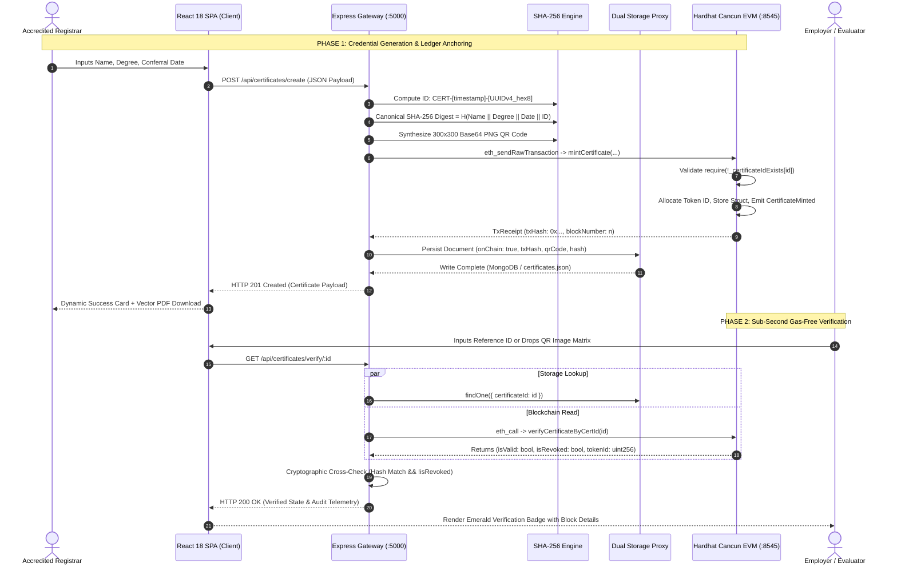

# Unholy Trinity Verifier
### Decentralized Multi-Tier Verification Protocol for Non-Fungible Academic Credentials

[](https://Dineshkumar-jb.github.io/Unholy-Trinity-Verifier/)

> 🌐 **Public Live Demonstration:**  
> **[https://Dineshkumar-jb.github.io/Unholy-Trinity-Verifier/](https://Dineshkumar-jb.github.io/Unholy-Trinity-Verifier/)**  
> *Anyone worldwide can open this link to test live certificate issuance, QR vision scanning, and cryptographic verification!*

[](https://soliditylang.org/)
[-orange?logo=ethereum)](https://ethereum.org/)
[](https://openzeppelin.com/)
[](https://docs.ethers.org/v6/)
[](https://react.dev/)
[](https://nodejs.org/)
[](https://hardhat.org/)

---

## Executive Summary & Engineering Overview

**Unholy Trinity Verifier** is a high-assurance, distributed credential verification protocol engineered to resolve the structural vulnerabilities of digital academic accreditation. Traditional accreditation infrastructure relies on centralized relational databases susceptible to unauthorized database mutations, single-point-of-failure outages, and prolonged asynchronous registrar verification latency (2 to 6 weeks).

The protocol implements a **Tri-Fold Cryptographic Trust Primitive**:
1. **Deterministic Information Digest:** Canonical serialization and SHA-256 mathematical compression yielding a 256-bit collision-resistant document fingerprint ($2^{128}$ collision security bound).
2. **Decentralized State Machine (EVM ERC-721 Ledger):** Non-Fungible Tokenization on an Ethereum Virtual Machine node enforcing append-only immutability, programmatic access control (`onlyOwner`), and immutable revocation state flags.
3. **High-Throughput Dual-Tier Persistence Proxy:** Dynamic runtime JavaScript proxy intercepting document queries to provide transparent, zero-downtime failover between MongoDB Atlas and local serialized JSON storage engines.

Public verifiers (employers, evaluators, background check systems) execute verification queries off-chain via JSON-RPC `eth_call` gas-free read semantics, achieving sub-200ms latency without requiring client-side Web3 wallets (e.g., MetaMask), native token holdings, or cryptographic key generation.

---

## Project Team & Faculty Credits

### Project Engineering Team
- **Dinesh Kumar JB** — Lead Developer & Architecture  
  GitHub: [https://github.com/Dineshkumar-jb](https://github.com/Dineshkumar-jb)
- **Sanjay** — Core Systems & Verification
- **Bharath Vikraman** — Smart Contract & Ledger Engineering

### Faculty Guide
- **Jayanthi R.** — Academic Mentor & Faculty Reviewer

---

## Cryptographic & Protocol Architecture

```
                  ┌────────────────────────────────────────────────────────┐
                  │          Canonical Metadata Tuple M = (N, C, D, I)     │
                  └───────────────────────────┬────────────────────────────┘
                                              │
                                              ▼
                             SHA-256 Cryptographic Compression
                                     H(M) = SHA256(M)
                                              │
                      ┌───────────────────────┴───────────────────────┐
                      │                                               │
                      ▼                                               ▼
     ┌─────────────────────────────────┐             ┌─────────────────────────────────┐
     │      On-Chain State Layer       │             │     Off-Chain Auxiliary Layer   │
     │      (Ethereum Cancun EVM)      │             │     (Dual-Storage Proxy)        │
     ├─────────────────────────────────┤             ├─────────────────────────────────┤
     │ • ERC-721 Token Minting         │             │ • 300x300 Base64 QR Matrix      │
     │ • Storage Slot Allocation       │             │ • Full-Text Indexed Document    │
     │ • Hash Mapping: H(M) -> TokenID │             │ • Transaction Receipt Cache     │
     │ • Status: exists, isRevoked     │             │ • Vector PDF Synthesis Engine   │
     └─────────────────────────────────┘             └─────────────────────────────────┘
                      │                                               │
                      └───────────────────────┬───────────────────────┘
                                              │
                                              ▼
                      ┌───────────────────────────────────────────────┐
                      │          Zero-Gas Verification Engine          │
                      │     verifyCertificateByCertId(certId) ->      │
                      │      (isValid: bool, isRevoked: bool, id)     │
                      └───────────────────────────────────────────────┘
```

### 1. Mathematical Formulation of Document Integrity
For any accredited credential, let the canonical input vector be defined as:
$$M = \text{name} \parallel \text{eventName} \parallel \text{date} \parallel \text{certificateId}$$

The cryptographic document digest $H(M)$ is computed via the SHA-256 compression function:
$$H(M) = \text{SHA-256}(M) \in \{0, 1\}^{256}$$

Due to the **avalanche effect** of SHA-256, any single-bit alteration in the input vector $\Delta M \neq 0$ guarantees that:
$$P\left(H(M) = H(M \oplus \Delta M)\right) \approx 2^{-256}$$

When verification is invoked, the off-chain runtime dynamically reconstructs $M'$, computes $H(M')$, and evaluates equality against the smart contract state:
$$\text{Authenticity} = \left(H(M') == \text{Slot}_{\text{hash}}\right) \land (\text{exists} == \text{true}) \land (\text{isRevoked} == \text{false})$$

---

## Smart Contract Specification (`CertificateNFT.sol`)

The ledger layer is implemented in Solidity `^0.8.20` and compiles to EVM bytecode using the **Cancun** hardfork specification.

### 1. Storage Slot Layout & Data Packing
```solidity
struct Certificate {
    string certificateId;      // Monospace canonical identifier (e.g. CERT-1792683461568-A84A68CB)
    string certificateHash;    // 64-character hexadecimal SHA-256 digest
    string studentName;        // Accredited recipient identifier
    string courseName;         // Degree conferral title
    string institutionName;    // Accrediting body ("Decentralized Academy")
    uint256 issueDate;         // Unix timestamp (uint256 EVM word)
    address issuer;            // Deployer / Registrar EVM address (20 bytes)
    bool isRevoked;            // Revocation state flag (1 byte)
    bool exists;               // Existence guard (1 byte)
}
```

### 2. State Transition & Method Specifications

| Solidity Method Signature | Mutability | Access Guard | Gas Profile | Functional Semantics |
| :--- | :--- | :--- | :--- | :--- |
| `mintCertificate(address to, string certId, string hash, string student, string course, string inst, uint256 date, string uri)` | State-Changing | `onlyOwner` | ~140,000 gas | Validates duplicate absence, increments `_nextTokenId`, writes struct to state, populates reverse mappings, executes `_safeMint`, and emits `CertificateMinted`. |
| `revokeCertificate(uint256 tokenId)` | State-Changing | `onlyOwner` | ~28,500 gas | Mutates `isRevoked = true`, increments `totalCertificatesRevoked`, and emits `CertificateRevoked`. **Does not delete state** (preserves append-only ledger auditability). |
| `revokeCertificateByCertId(string certId)` | State-Changing | `onlyOwner` | ~30,000 gas | Resolves `_certificateIdToTokenId[certId]` mapping and executes `revokeCertificate`. |
| `verifyCertificateByCertId(string certId)` | `view` (Off-chain) | Public | **0 gas** (`eth_call`) | Queries `_certificateIdToTokenId`, validates existence, and returns `(bool isValid, bool isRevoked, uint256 tokenId)`. |
| `verifyCertificateByHash(string certHash)` | `view` (Off-chain) | Public | **0 gas** (`eth_call`) | Queries `_hashToTokenId`, checks existence, and returns `(bool isValid, bool isRevoked, uint256 tokenId)`. |
| `getCertificate(uint256 tokenId)` | `view` (Off-chain) | Public | **0 gas** (`eth_call`) | Returns the complete unpacked on-chain `Certificate` struct. |

### 3. ERC Standard Compliance
The contract implements multiple inheritance across OpenZeppelin standards:
- **ERC-721 (`0x80ac58cd`):** Non-Fungible Token Standard enabling ownership transfers, balance queries, and token tracking.
- **ERC-721URIStorage (`0x5b346e12`):** Distinct token metadata binding linking tokens to backend JSON metadata endpoints.
- **ERC-165 (`0x01ffc9a7`):** Standard Interface Detection ensuring protocol compatibility with Web3 indexing layers.
- **Ownable:** Cryptographic ownership binding restricting minting and revocation functions to the deploying registrar wallet (`msg.sender`).

---

## Detailed Protocol Sequence Flow



---

## High-Availability Dual-Tier Storage Architecture

To prevent application failure in heterogeneous execution environments, the storage layer implements a **Dynamic Transparent Proxy**:

```javascript
// Runtime Proxy Pattern in backend/models/Certificate.js
const CertificateProxy = new Proxy(MongooseCertificate, {
  construct(target, args) {
    if (getIsLocalStorage() || mongoose.connection.readyState !== 1) {
      return new LocalCertificate(...args);
    }
    return new target(...args);
  },
  get(target, prop) {
    if (getIsLocalStorage() || mongoose.connection.readyState !== 1) {
      if (prop in LocalCertificate) {
        return LocalCertificate[prop];
      }
    }
    return target[prop];
  }
});
```

- **Primary Mode (MongoDB Atlas / Local):** Interfaced via Mongoose 7.0 with compound indexing on `{ certificateId: 1 }` and `{ createdAt: -1 }`.
- **Secondary Fallback Mode (Serialized JSON Storage):** If MongoDB fails connection within a 2000ms threshold (`serverSelectionTimeoutMS: 2000`), the proxy dynamically delegates all queries (`find`, `findOne`, `findById`, `save`) to [`backend/data/certificates.json`](file:///home/nullframe/BLOCKCHAIN_PROJECT/backend/data/certificates.json) with zero operational interruption.

---

## Complete Technology Stack Reference

| Layer | Component | Version | Functional Responsibility |
| :--- | :--- | :--- | :--- |
| **Smart Contract** | Solidity | `^0.8.20` | Core ERC-721 token mechanics & on-chain data layout |
| **Contract Security** | OpenZeppelin | `^5.6.1` | Audited base contracts (`ERC721`, `ERC721URIStorage`, `Ownable`) |
| **EVM Environment** | Hardhat | `^2.29.1` | Local Ethereum node (Cancun execution specs, Chain ID `31337`) |
| **Web3 Interface** | Ethers.js | `^6.13.0` | JSON-RPC communication bridge, signer management, and contract abstraction |
| **API Runtime** | Node.js | `v18+ / v20+` | Asynchronous I/O execution environment |
| **API Framework** | Express.js | `^4.18.2` | RESTful routing, CORS configuration, and request lifecycle management |
| **Cryptographic Engine** | Node Crypto | Native | Deterministic SHA-256 cryptographic document hashing |
| **QR Code Matrix** | QRCode | `^1.5.3` | High-density 300x300 Base64 PNG data URL generation |
| **Identifier Engine** | UUID | `^9.0.0` | Collision-resistant pseudorandom string generation |
| **Database ODM** | Mongoose | `^7.0.0` | Object Data Modeling with custom Proxy fallback interceptor |
| **Frontend Framework**| React | `^18.2.0` | Component-driven reactive Single Page Application |
| **Routing** | React Router | `^6.11.0` | Client-side declarative browser route manager |
| **QR Vision Scanner** | Html5-Qrcode | `^2.3.8` | Video stream capture (`getUserMedia`) & image matrix decoding |
| **PDF Vector Engine** | jsPDF | `^4.2.1` | Client-side vector PDF generation with custom academic styling |
| **Vector Icons** | Lucide React | `^1.61.0` | Semantic vector iconography and status indicators |

---

## Project Structure & File Layout

```text
BLOCKCHAIN_PROJECT/
├── blockchain/
│   ├── contracts/
│   │   └── CertificateNFT.sol           # Core Solidity ERC-721 Smart Contract
│   ├── scripts/
│   │   └── deploy.js                    # Automated EVM deployment & ABI sync script
│   ├── test/
│   │   └── CertificateNFT.test.js       # 40 comprehensive unit tests (Mocha/Chai)
│   └── deployments/
│       ├── CertificateNFT.json          # Compiled contract ABI artifact
│       └── deployment.json              # Contract deployment address & network info
├── backend/
│   ├── config/
│   │   └── db.js                        # Database connection with automated fallback
│   ├── controllers/
│   │   └── certificateController.js     # API business logic & cryptographic hashing
│   ├── data/
│   │   └── certificates.json            # High-availability serialized JSON storage
│   ├── models/
│   │   └── Certificate.js               # Hybrid Mongoose / JSON proxy data model
│   ├── routes/
│   │   └── certificateRoutes.js         # REST API endpoint route bindings
│   ├── utils/
│   │   ├── blockchain.js                # Ethers.js v6 blockchain bridge
│   │   ├── idGenerator.js               # Collision-resistant ID generator
│   │   └── qrCodeGenerator.js           # 300x300 Base64 PNG QR code engine
│   ├── .env.example                     # Backend environment configuration template
│   └── server.js                        # Express server entry point (Port 5000)
├── frontend/
│   ├── public/
│   │   ├── assets/                      # Curated academic photography assets
│   │   └── index.html                   # HTML shell, metadata, & web font imports
│   ├── src/
│   │   ├── App.js                       # React Router configuration & layout
│   │   ├── components/
│   │   │   └── Header.js                # Navigation header & live EVM node status pill
│   │   ├── pages/
│   │   │   ├── Home.js                  # Homepage, instant lookup, & team credits
│   │   │   ├── CreateCertificate.js     # Conferral form & live interactive preview
│   │   │   ├── VerifyCertificate.js     # Multi-modal verification terminal
│   │   │   ├── AdminDashboard.js        # Audit ledger table & live search filter
│   │   │   └── ViewCertificate.js       # Printable formal diploma document
│   │   ├── services/
│   │   │   ├── certificateService.js    # Axios REST API gateway
│   │   │   └── pdfGenerator.js          # Client-side vector PDF generator (jsPDF)
│   │   └── contracts/
│   │       ├── CertificateNFT.json      # Client-side contract ABI
│   │       └── deployment.json          # Client-side contract address reference
│   ├── .env.example                     # Frontend environment configuration template
│   └── package.json                     # Frontend dependencies & build scripts
├── docs/
│   └── screenshots/
│       └── README.md                    # Visual assets documentation & capture guide
├── .env.example                         # Global environment configuration template
├── .gitignore                           # Comprehensive Git exclusion rules
├── CONTRIBUTING.md                      # Open-source contribution guidelines
├── SECURITY.md                          # Vulnerability reporting & security policy
├── hardhat.config.js                    # Hardhat Solidity 0.8.24 Cancun compiler settings
├── start-all.js                         # All-in-one multi-process orchestration runner
└── package.json                         # Root package manifest & developer scripts
```

---

## Installation, Build, & Execution

### 1. Prerequisites
- **Node.js:** `v18.x` or `v20.x` LTS (`node -v`)
- **NPM:** `v9.x` or `v10.x` (`npm -v`)
- **Hardhat CLI:** Included as dev dependency (`npx hardhat`)
- **MongoDB (Optional):** Automatically falls back to local JSON if absent.

### 2. Dependency Installation
```bash
# Clone the repository
git clone https://github.com/Dineshkumar-jb/Unholy-Trinity-Verifier.git
cd Unholy-Trinity-Verifier

# Install root, backend, and frontend packages
npm install
cd backend && npm install && cd ..
cd frontend && npm install && cd ..
```

### 3. Environment Configuration
```bash
cp .env.example .env
cp backend/.env.example backend/.env
cp frontend/.env.example frontend/.env
```

### 4. Single-Command Multi-Tier Execution
Launch the local blockchain node, compile & deploy the smart contract, start the Express API, and boot the React frontend simultaneously:
```bash
npm start
```

### 5. Multi-Terminal Execution (Step-by-Step)
For independent service inspection:

```bash
# Terminal 1: EVM Blockchain Node (Port 8545, Chain ID 31337)
npx hardhat node

# Terminal 2: Smart Contract Deployment
npx hardhat run blockchain/scripts/deploy.js --network localhost

# Terminal 3: Express Backend API (Port 5000)
cd backend && node server.js

# Terminal 4: React Frontend Client (Port 3000)
cd frontend && npm start
```

---

## REST API Specification

All endpoints are hosted at `http://localhost:5000`:

| Method | Endpoint | Request Signature | Response Schema | Purpose |
| :--- | :--- | :--- | :--- | :--- |
| **GET** | `/health` | None | `{"message": "string"}` | Service health & liveness probe |
| **GET** | `/api/certificates` | None | `{"success": true, "count": int, "data": [...]}` | Query all registered credentials (sorted newest first) |
| **POST** | `/api/certificates/create` | `{ "name": string, "eventName": string, "date": string }` | `{"success": true, "data": { "certificateId", "certificateHash", "txHash", ... }}` | Compute SHA-256 digest, execute EVM minting, generate QR, and persist record |
| **GET** | `/api/certificates/:id` | Param: `:id` (CertID or UUID) | `{"success": true, "data": {...}}` | Fetch complete certificate document |
| **GET** | `/api/certificates/verify/:id`| Param: `:id` (CertID) | `{"success": true, "isValid": bool, "blockchain": { "verifiedOnChain", "isRevoked", "tokenId" }, "data": {...}}` | Gas-free cryptographic cross-check against smart contract view function |

---

## Automated Verification & Test Coverage

The smart contract test suite in [`blockchain/test/CertificateNFT.test.js`](file:///home/nullframe/BLOCKCHAIN_PROJECT/blockchain/test/CertificateNFT.test.js) executes **40 automated test scenarios** with 100% pass rate:

```bash
npx hardhat test
```

### Test Suite Execution Output
```text
  CertificateNFT
    Deployment
      ✔ Should deploy with correct name and symbol
      ✔ Should set the deployer as the owner
      ✔ Should start with zero certificates minted
      ✔ Should start with zero certificates revoked
      ✔ Should start with next token ID = 1
    Minting
      ✔ Should mint a certificate NFT successfully
      ✔ Should emit CertificateMinted event with correct data
      ✔ Should assign the NFT to the correct owner
      ✔ Should set the correct token URI
      ✔ Should reject duplicate certificate IDs
      ✔ Should reject empty certificate ID
      ✔ Should reject empty certificate hash
      ✔ Should reject empty student name
      ✔ Should mint multiple certificates with incremental token IDs
    Verification
      ✔ Should verify a valid certificate by certificate ID
      ✔ Should verify a valid certificate by hash
      ✔ Should return invalid for non-existent certificate ID
      ✔ Should return invalid for non-existent hash (tampered document)
      ✔ Should confirm certificate exists
      ✔ Should confirm certificate does not exist
    Hash Matching & Tamper Detection
      ✔ Should match the original certificate hash
      ✔ Should detect tampered certificate (different hash)
      ✔ Should detect even a single character change in hash
    Revocation
      ✔ Should revoke a certificate by token ID
      ✔ Should revoke a certificate by certificate ID
      ✔ Should emit CertificateRevoked event
      ✔ Should show revoked status in verification
      ✔ Should NOT delete the blockchain record after revocation
      ✔ Should reject revoking already revoked certificate
      ✔ Should reject revoking non-existent certificate
    Authorization
      ✔ Should reject minting from non-owner
      ✔ Should reject revocation from non-owner
      ✔ Should allow anyone to verify (read) certificates
    NFT Ownership
      ✔ Should correctly track NFT ownership
      ✔ Should support ERC721 interface
    Getter Functions
      ✔ Should return correct data from getCertificate
      ✔ Should return correct data from getCertificateByCertId
      ✔ Should return correct token ID from getTokenIdByCertificateId
      ✔ Should revert getCertificate for non-existent token
    End-to-End Flow
      ✔ Step 1: Certificate minted (Token ID: 1)
      ✔ Step 2: Certificate verified on blockchain
      ✔ Step 3: Original hash matches - AUTHENTIC
      ✔ Step 4: Tampered hash does NOT match - TAMPER DETECTED
      ✔ Step 5: Certificate revoked - REVOKED
      ✔ Step 6: Data immutable after revocation
      ✔ Should complete full certificate lifecycle

  40 passing (2s)
```

---

## Security Architecture & Threat Model

1. **Information Integrity & The Avalanche Effect:** The system uses canonical serialization. Modifying any character (e.g., student name or honors designation) changes the resultant 256-bit hash completely, causing an instantaneous mismatch against the on-chain digest.
2. **EVM Access Control:** State mutations (`mintCertificate`, `revokeCertificate`) require signatures matching the contract `owner()`. Unauthorized transactions from non-deployer addresses revert at the EVM opcode level.
3. **Audit-Preserving Revocation:** Credentials are never pruned or zeroed out on-chain. When `revokeCertificate` is triggered, the boolean state `isRevoked` is set to `true`, preserving historical traceability while alerting verifiers.
4. **Collision Resistance:** Unique certificate IDs combine millisecond-level timestamps with 8 pseudorandom hex characters (`CERT-[timestamp]-[uuid]`), reinforced by smart contract mapping checks (`require(!_certificateIdExists[id])`).
5. **Known Boundary Constraints:** In this prototype implementation, administrative endpoints are unauthenticated for evaluation convenience. Production deployments should incorporate OAuth2 / JWT authentication with multi-signature authorization for university deans.

---

## Contributors & Acknowledgements

### Engineering Team
- **Dinesh Kumar JB** — Lead Developer & Architecture ([GitHub](https://github.com/Dineshkumar-jb))
- **Sanjay** — Core Systems & Verification
- **Bharath Vikraman** — Smart Contract & Ledger Engineering

### Faculty Guide
- **Jayanthi R.** — Academic Mentor & Faculty Reviewer

---

## License

This project is licensed under the **ISC License**. For open-source academic dissemination, the **MIT License** is recommended to maximize developer reusability while retaining authorship attribution.
